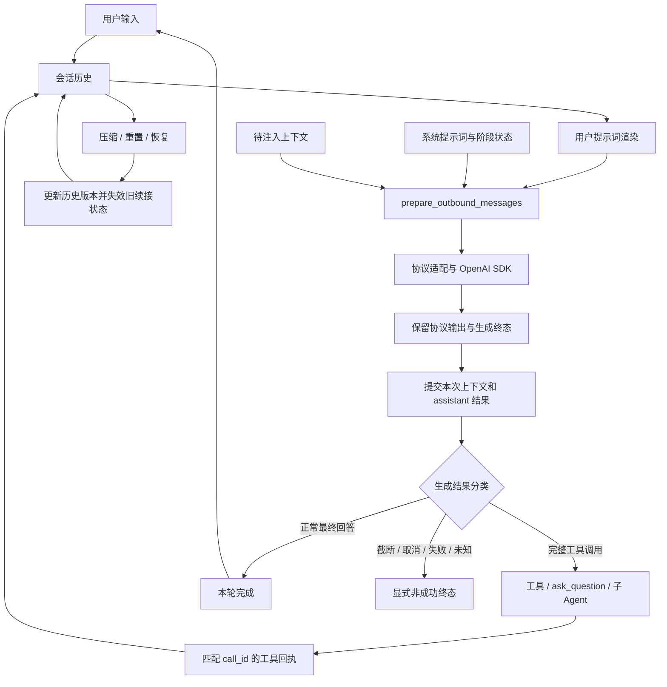

# Agent 消息流程修复方案

日期：2026-10-17

状态：修复与本轮验证完成。用户已确认将真实远端续接成功保留为受服务端限制的未验证项；详细结果、恢复轨迹与业务验收边界见[执行记录](2026-10-18-agent-message-flow-repair-progress.md)。

阅读约定：本文的问题描述与“当前实现”均以 2026-10-17 审查时的代码为基线，保留当时的证据与修复要求；不表示这些缺口在后续工作树中仍全部存在。实际完成情况以执行记录为准，本文的验收范围保持不变。

范围：Responses 协议状态、会话续接、生成终态、子 Agent 结果，以及 `examples/e2e/plan_and_task` 的相关验证。

## 1. 结论与背景

当前 Agent 的输入、提示词渲染、模型适配、工具执行和观测分层总体合理，正常成功路径有较充分的测试。但审查已经复现四类契约缺口，因此暂时不能认定整个消息流程设计正确。

| 编号 | 问题 | 直接影响 |
|---|---|---|
| A | Responses 原始输出项在转换为 `Message` 时丢失 | 无状态工具循环不能完整回放模型返回的推理状态 |
| B | 远端 response 续接状态未绑定本地历史与 provider | 重置、压缩、切换模型后可能引用失效或属于旧任务的 response |
| C | 上层没有消费生成结束原因 | 截断、取消、未知结束可能被报告为正常完成 |
| D | 子 Agent 结果缺少可靠的运行终态 | 子任务失败后，父 Agent 可能收到中间文本和错误的成功标记 |

OpenAI SDK 迁移已经完成，但 SDK 负责传输和响应解析，不能替框架保留被丢弃的协议状态，也不能修正上层状态机。上述四项修复属于框架消息契约的修复。

本方案的实施顺序为 **C → D → A → B → 完整 e2e 与缓存复查**：先让失败和不完整结果被正确识别，再完善本地回放与远端续接。

## 2. 当前消息流程与应保留的设计

### 2.1 主循环

以 `examples/e2e/plan_and_task` 为例，系统执行顺序如下。不同优先级顺序执行，同优先级通过 `TaskGroup` 并发；存在数据依赖的系统必须位于不同优先级。

| 优先级 | 系统 | 消息职责 |
|---|---|---|
| -30 | `CompactionSystem` | 检查上下文预算，必要时摘要或重写历史 |
| -15，交互前端安装 | `UserInputSystem` | 将输入 Future 返回的用户文本追加到历史 |
| -10 | `UserPromptNormalizationSystem` | 展开命令与脚本，冻结之前已经发送的用户渲染结果 |
| -5 | `SystemPromptRenderSystem` | 生成稳定 system 前缀和随阶段变化的部分 |
| -3 | `StatusCommandSystem` | 本地状态查询，直接展示 |
| -1 | `SubagentSystem` | 管理子任务会话、结果、等待和通知 |
| 0 | `ReasoningSystem` | 组装请求、调用模型、提交结果、决定继续工具循环或结束 |
| 1 / 3，按前端安装 | `TerminalCleanupSystem` | 清理可恢复的终止标记，准备后续交互 |
| 5 | `ToolExecutionSystem` | 执行待处理工具并追加对应回执 |
| 99 | `ErrorHandlingSystem` | 发布错误事件并清理临时错误组件 |



图中的“保留协议输出”“生成结果分类”“历史版本与续接失效”是本次需要补齐的契约，不能理解为已经全部实现。

### 2.2 请求与历史提交

1. `assemble_messages` 组织稳定系统提示词、可变系统尾部、额外前缀、会话历史和尾部上下文池。
2. `prepare_outbound_messages` 获取历史、替换当前用户消息的渲染结果、修复中断遗留的工具回执并按预算裁剪。
3. 实际发送的上下文块通过 reservation 跟踪。成功接收结果后，先提交这些上下文，再提交 assistant；失败重试必须防止上下文被提前消费或重复插入。
4. Responses 将 system 消息映射为 `instructions`，工具调用和回执分别映射为 `function_call` 与 `function_call_output`，使用 `call_id` 配对。
5. 允许并发的工具可在组内并发运行，但回执按原始调用顺序写入；具有写入副作用的工具通过独立执行组形成屏障。

EventBus、MessageBus 的控制与观测事件不自动等于模型历史。只有明确的 collector、工具返回或历史提交操作才能将内容加入模型上下文。

### 2.3 子 Agent 与辅助模型调用

子 Agent 使用独立 child World 和历史，以委派任务作为用户输入。工具、技能、权限、workspace 和提示词按继承策略传递，不自动复制父 Agent 的完整聊天记录。同步委派经工具结果返回，后台委派经 session/result/wait/notification 返回。

Planning、Replanning 和摘要模型调用具有各自用途。其 response ID、生成结果与用量应按调用归属管理，不能混入主对话的续接状态或用一个合并缓存率替代各路径验证。

## 3. 已确认的 `enable_store` 语义

### 3.1 与 SDK 的 `store` 一一对应

`enable_store` **只控制本次生成的 response 是否存储**，默认行为与 SDK 未指定 `store` 时一致。

| 框架配置 | 发送给 SDK / API 的行为 |
|---|---|
| `enable_store=True` | 明确发送 `store=True` |
| `enable_store=False` | 明确发送 `store=False` |
| 未设置 | 省略 `store`，遵循服务端默认值 |

本地安装的 OpenAI Python SDK 2.54.0 中，`responses.create` 的参数定义是 `store: Optional[bool] | Omit = omit`，`previous_response_id` 也是独立参数。框架必须保留“未设置”和显式 `False` 的区别，不能继续使用布尔真值判断来决定是否输出参数。

配置层的未设置值表示方式属于实现细节。可以采用项目自己的 unset 标记，或约定 `None` 表示框架的“未设置”；如采用后一种方式，必须明确它映射到 SDK 的省略参数，而非发送 JSON `null`。不要把这种内部映射描述成 SDK 的 `None` 与 `omit` 相同。

### 3.2 存储、续接和缓存各自独立

- `enable_store=True` 不自动开启会话续接；自动续接由框架的独立策略决定。
- `enable_store=False` 不禁止本次请求引用此前已经存储、且仍有效的 `previous_response_id`。
- 本次明确不存储的 response，即使返回 ID，也不能被登记为后续自动续接的有效锚点；该 ID 仍可用于日志与用量关联。
- 未指定 `store` 时，不应仅凭返回 response ID 就假设兼容网关已经存储了 response。自动续接需要已知的 provider 能力或存储状态依据。
- `store=False` 不表示关闭 Prompt Cache；存储开关不能用于推断缓存命中或计费折扣。

以下组合必须能够被正确表达：

```python
# 语义示例：本次使用此前已存储的上下文，但不存储本次生成结果。
await client.responses.create(
    model=model,
    previous_response_id="resp_previously_stored",
    input=new_input,
    store=False,
)
```

### 3.3 当前实现的偏差与迁移要求

目前 `ProviderConfig` / `ProviderEntry` 默认 `enable_store=False`，但 adapter 在 `False` 时省略 `store`；同时只有 `True` 才发送 `previous_response_id`。这同时混淆了显式不存储、默认行为和自动续接。

修复时必须同步覆盖配置 dataclass、`ProviderEntry.from_dict`、registry 传递、适配器、Reasoning 注释与行为、序列化、示例配置、测试和文档。原来显式配置 `False` 的请求将开始实际发送 `store:false`，这是需要说明的行为修正。

兼容网关不支持 `store` 时，应使用明确的能力配置或返回明确错误。尤其不能在收到拒绝后静默删除显式的 `store=False`，因为这样会改变调用者要求的存储语义。

### 3.4 配置落地约定

配置采用 `enable_store: bool | None = None`：`None` 仅作为框架的未设置标记，构造 SDK 请求时省略 `store`。自动续接采用独立的 `enable_response_chaining: bool = False`；开启后仍需通过第 5 节的来源、历史前缀和存储有效性检查。

example 对应环境变量为 `LLM_ENABLE_STORE` 与 `LLM_ENABLE_RESPONSE_CHAINING`。前者未设置时省略 `store`，显式 true / false 分别传递布尔值；后者默认关闭。迁移后的存储配置不再隐式改变续接策略。

## 4. 修复 A：完整保留和回放 Responses 输出项

### 4.1 问题与证据

`openai_responses_adapter.py` 当前将 response output 解析为文本、工具调用和 reasoning summary；`Message` 没有保存完整 Responses 输出项。下一次请求只能从归一化消息重建部分 input。

已复现：模型返回 `reasoning(id, encrypted_content) + function_call`，执行工具后下一轮只有 user、function call 和 function output，原始 reasoning item 消失。可展示的 reasoning summary 不能替代 opaque reasoning 状态。

[OpenAI reasoning 指南](https://developers.openai.com/api/docs/guides/reasoning)要求在相关函数调用续轮中保留推理项，可通过远端续接或完整输出项回放实现。本问题证明本地状态保留有缺口，但不能直接认定它就是此前缓存零命中的原因。

### 4.2 目标设计

采用“可回放的协议状态 + 派生的展示内容”设计，`Message.content` 不再承担保存全部 provider 状态的职责。

1. 在 `CompletionResult` 与持久化的 assistant `Message` 中增加可选的 provider 输出状态。类型采用项目 dataclass 和可序列化 JSON 数据，不把 OpenAI SDK / Pydantic 对象作为核心持久化模型。
2. 保存协议标识、来源标识和有序 output items，保留 reasoning 的 opaque 字段、原始 function-call arguments、item ID、call ID 以及重放所需信息。字段名在实现时统一确定。
3. `content`、`tool_calls`、可展示的 reasoning summary 由同一份响应派生，用于展示与工具分派。存在有效原始输出状态时，下一次 Responses input 优先从它回放，避免重复生成同一 function call。
4. 只回放 API 接受的 item 结构；必要转换必须显式、可测试。不能用“保留原始状态”为由把整个 response envelope 直接当成 input。
5. 将协议状态绑定到可支持它的 provider 来源。切换 provider 或协议时必须校验；不能把私有 opaque 状态发送到无关 endpoint。

### 4.3 非流式、流式与持久化

非流式从完整 response output 构造协议状态。流式按 `output_index` / item ID 汇聚项目，在 done 事件和最终 response 之间去重，按原顺序形成同等结果。只有 delta 的半截项目不能当成完整可执行工具调用。

取消或 EOF 时保留已经产生的可展示内容和明确的非成功状态；对未完成的协议项标记完整性，后续能否重放由协议校验决定。

`WorldSerializer`、checkpoint、恢复、复制和相关历史操作必须保留新增字段。旧快照缺少字段时仍可加载，并明确属于历史的有损表示；不得凭空补造 reasoning state。

压缩时把 reasoning、function call 和对应 function output 作为有关联的工具段处理。可以整体保留或在可压缩边界整体替换为摘要，不能留下孤立工具回执或删除尚需续轮的推理状态。

### 4.4 主要改动位置与验收

主要位置：`src/ecs_agent/types.py`、Responses adapter、`systems/reasoning.py`、`serialization.py`、compaction / context 相关代码。

验收用例：

- 普通与流式工具循环均保留原始 reasoning item、call ID、arguments 和项目顺序。
- 混合文本、reasoning、多工具调用不重复、不丢项。
- save/load、checkpoint 恢复后，下一次协议输入与恢复前等价。
- 中断留下的半截工具调用不执行；压缩前后不存在孤立工具回执。
- 跨 provider 切换不误用原 provider 的 opaque 状态；旧 Message 与旧快照保持可读。

## 5. 修复 B：续接状态绑定历史版本与 provider

### 5.1 问题与证据

`ResponsesAPIStateComponent` 当前只有 `previous_response_id` 和 `covered_message_count`。压缩、工作流重置和模型切换没有统一清理该状态，计数不能证明本地历史仍等于远端已经覆盖的前缀。

已复现三种错误：重置工作流后继续引用旧任务 response；压缩为一条摘要后仍引用压缩前 response；切到另一 endpoint 后仍发送原 provider 的 response ID。

在审查时的实现中，此问题由 `enable_store=True` 打开续接后触发。example 默认路径没有启用该续接行为，因此不能用这些反例解释默认场景的全部缓存现象。修复后应按独立的续接策略描述触发条件，不再与存储参数混写。

### 5.2 续接状态与独立策略

扩展状态，使续接锚点至少包含以下含义；字段名属于拟议设计：

| 信息 | 用途 |
|---|---|
| response ID | 要引用的远端响应 |
| provider / endpoint / model / 协议及凭据作用域身份 | 防止跨来源或不兼容模型误用；不保存明文密钥 |
| conversation ID 与历史修订版本 | 区分任务边界与破坏性历史变更 |
| 已覆盖协议项边界与前缀指纹 | 证明可省略的输入确实已在远端上下文中 |
| 存储与有效性状态 | 区分明确已存储、未存储、未知、已失效 |
| 失效原因 | 支持诊断和测试 |

自动续接策略独立决定何时采用有效锚点，不能由 `enable_store` 隐式启用。显式传入 `thread_response_id` / `previous_response_id` 与自动选择锚点也要区分，避免自动历史裁剪覆盖调用者明确提供的增量输入契约。

协议输入项的规范化表示用于比较历史前缀；不能继续仅按 Message 数量判断，因为一条 assistant Message 可以映射到多个 output items。比较过程保留项目数组顺序和不透明字符串，只对无语义影响的对象键顺序等做规范化。

当前请求的 `instructions`、工具与输出格式仍按本次配置发送。对会改变输入历史构造的配置纳入一致性检查，不能假设服务端会自动继承所有请求级参数。

### 5.3 历史变更统一入口

建立统一的历史提交、替换、重置、恢复和续接失效入口。普通追加允许延续已有前缀；修改旧内容、压缩、裁剪或分支切换属于需要重新验证的变更。

| 操作 | 续接处理 |
|---|---|
| 追加用户输入、有效工具回执、assistant 输出 | 前缀和来源一致时允许继续 |
| 新工作流 / 清空历史 / 编辑旧消息 | 失效旧锚点，下一次使用当前完整历史 |
| 摘要压缩 / 删除旧工具段 / 出站裁剪已覆盖前缀 | 失效或证明等价后才可续接；默认走完整历史 |
| 切换 provider、endpoint、凭据作用域或模型 | 保守地失效旧锚点 |
| checkpoint 恢复 / 会话分支切换 | 重新验证来源、前缀和远端有效性，不凭旧计数直接续接 |
| 本次 `store=False` | 可使用此前有效锚点，但本次 response 不成为新锚点 |

发送前必须核对实际出站历史，而不只是最初的平面历史；渲染、上下文注入和预算裁剪都可能改变最终 input。成功后仅提交本次实际覆盖的上下文和符合存储条件的新锚点。

去掉“裁剪后没有新输入，就保留完整 input 同时继续发送 previous_response_id”的回退方式，避免重复远端已有上下文。无增量输入时明确选择合法空增量请求或重建完整请求，按 provider 能力处理。

### 5.4 失效与兼容回退

对明确指向 previous response 无效、过期或不存在的错误，清除锚点，在没有向上层交付任何输出且具备完整本地回放能力时，最多重试一次不带 `previous_response_id` 的完整请求。

不能将所有 HTTP 400 / 404 都当作续接失效，也不能将 response ID 不存在的 404 当成整个 Responses endpoint 不存在。Responses → Chat 的兼容回退需要单独识别 endpoint 能力错误。

流已经对外产生输出后，不透明地重放请求可能造成重复内容或重复工具执行，应将错误和可恢复状态交给上层。无法安全重建完整协议历史时返回明确失败，不能假装回退是无损的。

### 5.5 主要改动位置与验收

主要位置：provider config / registry、`ResponsesAPIStateComponent`、Reasoning、Responses adapter、OpenAI facade、compaction、serialization / checkpoint、example 工作流重置入口。

验收用例：

- `True`、`False`、未设置三种配置的实际 HTTP JSON 分别为 `store:true`、`store:false`、无 `store`。
- `store=False` 与有效的既有 `previous_response_id` 可以同时发送；本次返回 ID 不被自动续用。
- 存储开关与自动续接策略分别验证，不存在隐式联动。
- 工作流重置、压缩和跨 provider 切换的三个审计反例转为通过。
- 相同消息数量但不同内容、一个 Message 对应多个 item、恢复旧快照和出站裁剪均不误删输入。
- 正常续接只发送尚未覆盖的增量；不出现完整历史与远端上下文重复叠加。
- 无效 response ID 只触发一次可验证的完整重试；endpoint 404、其他 400 和流中途错误分别处理。

## 6. 修复 C：生成终态贯穿状态机、事件与展示

### 6.1 问题与证据

适配器和 `_process_streaming` 已能产生 `LENGTH`、`CANCELLED`、`UNKNOWN`，但 `ReasoningSystem.process` 主要根据是否存在工具调用决定执行工具或写入 `reasoning_complete`。

审计中的 `response.incomplete(max_output_tokens)`、`response.cancelled` 和缺少终止事件的 EOF，均被上层报告为普通完成。这会掩盖半截回答，也让子 Agent 成功判定缺乏可靠基础。

### 6.2 统一结果分类

在普通与流式路径汇合后，统一解释 provider 状态、`finish_reason`、输出完整性和工具合法性。下表是目标语义，具体类型与枚举命名在实现时统一。

| 结果 | 上层处理 |
|---|---|
| 正常停止且存在有效最终结果 | 标记本轮完成，可产生成功的最终结果 |
| 完整且合法的工具调用 | 进入工具执行循环；这还不是整个任务完成 |
| token 上限 / incomplete | 保留部分内容，标记截断，交给明确的恢复策略 |
| 内容过滤 | 保留允许展示的内容与过滤原因，不伪装正常成功 |
| 用户或服务端取消 | 标记取消，不执行未完成工具 |
| 缺失终止事件 / 未知结束 | 标记未知或中断，不推断为 STOP |
| 网络 / provider / 解析错误 | 保留错误与已产生内容，进入错误处理 |

仅“出现工具调用字段”不意味着可以执行。必须验证工具名称、call ID、arguments 完整性与 schema，以及调用所在生成结果的状态。取消、截断或未知结束后的工具默认不自动执行；若将来允许执行部分已完成工具，需要独立、明确的恢复策略。

不默认对截断自动追加“继续”或重试模型调用，避免隐式重复工具副作用和追加费用。恢复策略必须显式管理已提交历史、已执行工具及重试边界。

### 6.3 用量与内容完整性分开

`UsageRecord.stream_completeness` 描述用量信息完整性，不是回答完整性。收到完整 usage 的 `LENGTH` 结果，其用量仍可以是 `COMPLETE`；缺少 usage 的 EOF 则不能伪装成明确完整用量。

在结果组件、终止原因、LLM invocation / completion 事件、日志、观测插件和 TUI 中传播生成状态与 `finish_reason`。若旧事件的 `status` 表示 HTTP 调用成功，则保留这一含义并增加生成结果字段；消费者不能再将传输成功直接当作任务成功。

部分内容可以保存和展示，但需带非成功标记，并且不能作为成功最终回答。历史与上下文 reservation 的提交规则应明确区分“收到可记录的部分结果”和“完成一次可继续的工具轮次”。

旧 provider / FakeModel 没有 `finish_reason` 的兼容规则必须显式确定并测试。可以在已知具有完整非流式返回契约的边界归一化，不能全局把 `None`、未知流终态都当作 STOP。

### 6.4 主要改动位置与验收

主要位置：`types.py`、Reasoning、流式聚合、终态组件 / 事件、用量与观测映射、example TUI。

验收覆盖普通与流式的正常文本、完整工具调用、截断、过滤、取消、服务端失败和无终止事件 EOF；验证组件、事件和展示结论一致。三个不完整流审计反例必须转为通过，同时完整 usage 的截断结果不能被错误计为用量缺失。

## 7. 修复 D：子 Agent 返回结构化运行结果

### 7.1 问题与证据

`run_delegation` 在 Runner 返回后直接提取最后一条 assistant 文本；委派层只要没有抛异常就返回成功。但 Reasoning 会将模型异常转成错误和终止组件，Runner 正常返回不代表任务成功。

已复现：子 Agent 先输出“仍在工作”的中间文本并调用工具，随后模型请求超时，父 Agent 却得到该中间文本、`success=True` 和 `error=None`。临时 `ErrorComponent` 还可能被 ErrorHandlingSystem 清理，事后只检查该组件也不可靠。

### 7.2 Runner 与委派结果契约

让 Runner 产出或持久化可读取的结构化 `RunResult`，并由委派层生成 `DelegationResult`。名称为拟议名称，核心字段含义如下：

| 字段含义 | 用途 |
|---|---|
| run / child / correlation 身份 | 将结果绑定到正确的子任务 |
| 状态与终止原因 | 区分成功、失败、取消、超时、tick / 预算耗尽及未知结束 |
| final result / final message 身份 | 只引用已确认的最终结果 |
| partial content | 在非成功情况下保留有用的中间内容 |
| error 信息 | 保留失败原因，不依赖临时错误组件仍存在 |
| 可选 usage / artifacts 引用 | 供父任务和展示层追踪产物 |

Runner 的统一退出路径应先形成终态快照，再发布相应事件或清理临时状态。RunCompleted 事件和委派返回值从同一结果派生，避免两个位置各自判断成功。

成功必须有可靠的任务终态：目标 child 完成、没有待执行或未闭合的工具调用、没有未处理失败，并存在有效的最终结果。不能因为任意实体带有 TerminalComponent、协程正常返回或历史里存在 assistant 文本就判定成功。

结果可以是明确支持的结构化内容或产物引用，不应把“存在非空文本”硬编码为唯一成功条件。文本委派接口仍需要清楚定义从最终结果到文本的映射。

### 7.3 同步、后台与兼容接口

同步委派、后台 session、`subagent_result`、waiter 和完成通知必须消费同一份 `DelegationResult`。父 Agent 的工具回执应明确区分最终结果、部分内容与错误，不能把失败结果包装成普通成功文本。

保留现有字符串或 `(result, success, error)` 接口的过渡适配层时，必须从结构化结果派生；它不能再次从“有没有最后一条 assistant”推断 success。取消唤醒和 Future 解析沿用同一终态，防止不同消费者得到冲突结论。

Runner 当前返回 `None`。如直接增加返回值，要同步更新类型与调用方；如果需要保持公共签名，可提供统一内部运行结果入口。两种实现都必须确保结果有唯一可靠来源。

### 7.4 主要改动位置与验收

主要位置：`core/runner.py`、运行结果类型 / 组件、`systems/subagent/delegation.py`、`systems/subagent/__init__.py`、subagent runtime、事件与 example 消费端。

验收用例：

- 中间文本 → 工具成功 → 后续模型超时，返回失败与部分内容，不返回成功最终结果。
- 正常完成、没有有效最终结果、工具失败、取消、超时、max_ticks、预算耗尽分别产生一致状态。
- ErrorComponent 被清理后仍能取得真实失败原因。
- 同步、后台 result、waiter、事件和父 Agent 工具回执一致；取消不会留下永久等待的 Future。
- 一个子实体的终止不会被错误解释为目标任务成功。

## 8. 共同约束、兼容性与审查边界

### 8.1 必须建立的共同约束

1. 模型可见历史具有可回放的协议状态，展示内容只是其派生视图。
2. 已发送历史的修改必须显式影响版本与续接有效性；正常追加不重写历史中间位置。
3. 工具调用与回执保持身份、顺序和闭合关系；未完成调用不进入执行队列。
4. 生成状态、运行状态与用量完整性分别表达，并由统一结果向事件和展示传播。
5. 只有具备有效来源、历史匹配和存储依据的锚点才能用于自动续接。
6. 缓存正确性检查建立在消息正确性之后，缓存命中率不能替代上述契约。

### 8.2 兼容性处理

新增核心数据采用 `dataclass(slots=True)`、完整类型标注与可序列化字段，不使核心消息依赖 SDK 类型。新增字段对旧快照提供明确默认值；对于缺失的协议状态或远端有效性，选择可说明的回放 / 失效策略，不伪造数据。

新增生成状态和结构化委派结果需要同步检查事件订阅方、Langfuse / logging、billing 和 TUI。费用仍按实际 usage 记录，失败或截断不代表调用免费。

配置迁移明确区分“旧 `False` 实际省略参数”与“新 `False` 明确禁止本次存储”；自动续接迁入独立策略后不得暗中保留旧的存储开关联动。更新 README、models、Responses、streaming、subagent、serialization 与 example 文档中的相关说明。

### 8.3 额外边界

- `ConversationTree` 当前在组装时可成为读取来源，而输入、Reasoning、工具执行主要写平面历史。树会话的完整读写契约需单独定义；本轮平面流程测试不能证明树分支工作流已正确。
- 工具段校验应进一步覆盖未知 call ID、重复回执与顺序错误，尤其是 checkpoint / import 外部历史。A、B 涉及的回放和历史修改必须保证不扩大这类缺口。
- 不穷举第三方自定义系统和全部 provider 多模态组合。跨协议状态转换不支持时应清楚报出能力边界。

## 9. 实施步骤与验证计划

### 9.1 分阶段落地

| 顺序 | 工作 | 阶段出口 |
|---|---|---|
| 0 | 将审计反例整理为正式回归测试，保留原契约断言 | 四类问题可独立复现 |
| 1 | 修复 C：统一生成终态与用量完整性传播 | 三个不完整流反例通过，正常完成与工具循环不回归 |
| 2 | 修复 D：Runner / 委派结构化结果 | 子任务失败不再返回成功，同步与后台一致 |
| 3 | 修复 A：保留原始输出与完整回放 | reasoning 工具续轮、流式、save/load 均通过 |
| 4 | 修复 B：存储参数解耦、续接验证和失效规则 | 三个旧链反例及存储语义矩阵全部通过 |
| 5 | 运行完整 example 流程并复查缓存 | 消息状态、结果、用量和实际请求可逐轮对应 |

阶段 4 的无链重试依赖阶段 3 的完整回放。阶段 2 的成功判定依赖阶段 1 的可靠终态。每阶段只根据实际通过的验收更新状态，不将本方案本身作为修复已完成的证据。

### 9.2 离线验证

使用真实 OpenAI SDK + `httpx.MockTransport` 验证实际 HTTP JSON 和响应解析，避免仅 mock `responses.create` 而漏掉参数省略、流式解析或类型转换问题。

将当前审计目录中的八个契约反例纳入正式测试，并补齐上述矩阵。相关测试领域包括 Responses、streaming、SDK、provider registry、Reasoning、compaction、serialization / checkpoint、Runner、subagent、usage accounting 和 plan/task 集成测试。

按改动运行有针对性的测试，全部修复完成后执行完整测试与严格类型检查：

```bash
uv run pytest
uv run mypy src/ecs_agent/
```

记录新增失败与原有基线问题的区别。此前 SDK 迁移验证中存在 `tools/discovery.py` 与 `providers/claude_model.py` 两处既有 mypy 错误；实施前应重新核对，不能未经复测直接沿用旧结论。

### 9.3 完整 e2e 与缓存复查

通过 `PlanTaskDebugSession` 覆盖实际规划访谈、工具调用、子 Agent、评审、任务执行与恢复；另设包含压缩、工作流重置、模型切换、取消和子任务失败的场景。先证明消息与终态正确，再统计缓存。

对完整历史回放与有效远端续接分别采样，不将不同上下文策略的 token 数直接混作同一基线。采集 SDK 序列化后的请求结构、输出项、response ID、provider 原始 usage、框架 usage 和 example billing，按调用与响应身份对应。

检查稳定前缀、工具段闭合、协议状态回放、续接增量范围和状态传播。区分缓存字段缺失（`None`）、明确零值和正值；不能把全零样本跳过成“不支持缓存”。

缓存命中不是每次必须成立的正确性断言。若前缀正确且 SDK / billing 与原始 usage 一致，但网关仍返回零，应保留请求与响应身份供网关调查，不能仅凭小样本断定路由、过期或淘汰机制。参考 [OpenAI Prompt Caching 指南](https://developers.openai.com/api/docs/guides/prompt-caching)。

真实接口验证使用有上限的请求预算，记录实际运行范围；请求证据不保存 API key 或认证头。新一轮结果写入新目录，保留原始审计记录。

## 10. 已有验证证据与完成标准

### 10.1 2026-10-17 审查结果

这些是修复前的历史证据，不是本文新增验证结果：

| 验证 | 结果与范围 |
|---|---|
| 消息流程相关既有测试 | 521 passed，1 skipped；跳过项为缺少 key 的 live 子任务测试 |
| 新增审计契约探针 | 8 failed：A 一项、B 三项、C 三项、D 一项；均为契约断言失败 |
| SDK / 缓存 / 计费相关验证 | 124 passed；离线模拟的缓存数值不证明真实命中 |
| 实际网关请求 | 8 轮简化 IDLE e2e + 6 次相同请求对照，共 14 次 HTTP 200 |
| SDK 与原始响应核对 | 11 个 SDK 请求的 input / cached token 均一致；8 条 example 用量事件一致 |

八轮简化 e2e 的缓存 token 序列为 `[0, 0, 0, 0, 3510, 0, 0, 0]`，总输入 32,232 token，缓存读取 3,510 token，样本加权比例约 10.89%。七对相邻请求的 instructions、tools 和 input 历史前缀均保持一致。

六次相同请求对照中，SDK 的 cached token 为 `[0, 3886, 3886]`，原始 httpx 为 `[0, 0, 3758]`。两种方式都出现过命中和零值。该样本支持“SDK 没有丢失缓存统计，迁移未消除零命中现象”，不支持比较客户端长期命中率，也不覆盖完整规划 / 工具 / 子 Agent 工作流。

### 10.2 原始证据位置

以下 `records/review` 目录为本地审计产物，可能被 Git 忽略；本文已保存关键结论，克隆仓库后不应假设原始产物一定存在。

- [消息流程审计报告](../../records/review/message_flow_audit_2026-10-17/report.md)
- [八个消息契约反例](../../records/review/message_flow_audit_2026-10-17/test_contracts.py)
- [反例运行输出](../../records/review/message_flow_audit_2026-10-17/reproductions.log)
- [既有相关测试输出](../../records/review/message_flow_audit_2026-10-17/baseline-tests.log)
- [SDK 缓存复查报告](../../records/review/plan_task_sdk_cache_audit_2026-10-17/report.md)
- [缓存请求证据](../../records/review/plan_task_sdk_cache_audit_2026-10-17/requests.json)
- [example 计费事件证据](../../records/review/plan_task_sdk_cache_audit_2026-10-17/accounting.json)

当前审计反例可单独执行：

```bash
PYTHONPATH=. uv run pytest records/review/message_flow_audit_2026-10-17/test_contracts.py -q --tb=short
```

### 10.3 最终完成标准

- [x] 八个审计反例进入正式回归集并全部通过。
- [x] `enable_store` 的三种行为、与续接的独立性及配置迁移均有实际请求测试。
- [x] Responses 普通 / 流式 / 工具续轮 / save-load 保留可回放状态。
- [x] 重置、压缩、裁剪、恢复与 provider 切换不携带错误续接上下文。
- [x] 截断、取消、过滤、错误和未知终态不再伪装正常完成；用量完整性独立且准确。
- [x] 子 Agent 的同步、后台、通知与父工具结果使用一致的真实运行状态。
- [x] 相关回归、完整测试与类型检查执行完毕，遗留问题单独记录。
- [x] 完整 plan/task e2e 与缓存复查给出可对应的请求、状态和用量证据，并注明实际验证边界。
- [x] 对外文档、示例配置与兼容性说明反映实际完成的行为。
- [ ] 真实服务端的有效远端续接成功采样：受当前账户能力限制，按用户确认保留未验证，不作为本轮收尾阻塞项。


2026-10-18 验收说明：已勾选项目按实际证据完成。真实 plan/task 经过网络失败后的恢复到达 TASK_COMPLETED，产物另经独立测试核验，并非一次无中断成功运行。有效远端续接的真实成功采样未完成：当前账户返回 store:false，显式 previous_response_id 被 HTTP 400 拒绝；用户明确选择记录服务端限制、保留此项未验证。SDK MockTransport 的正向续接测试不能替代该真实证据。

此外，complete_task 记录调用者的完成声明，不独立判断任意业务验收。实测中模型曾未读取 bash 归档便声明完成；已补充读取说明、保留原记录，并通过真实后续核验及独立测试确认产物。此行为边界不应被 RunResult 的结构化成功状态掩盖。
