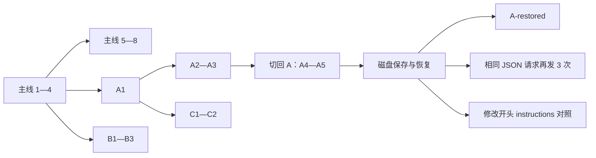

# 长上下文、多轮对话与分叉缓存专项测试

日期：2026-10-18。范围：Agent 发出的 Responses 上下文、分支隔离、协议回放和服务端 Prompt Cache 用量。

后续已完成 [DeepSeek Responses 直连对照](2026-10-18-deepseek-context-cache-comparison.md)：同一场景发送前预测 88.72%，实测 88.43%，具体比较与因果边界见该报告。

## 结论

**平铺历史 + WorldSerializer 快照分叉的客户端消息契约通过；缓存复用效率明显低于“既有前缀缓存持续可用”的理想基线；原生 ConversationTree 的完整多轮分叉仍未通过。**

- 真实接口：`api.rutaceae.com`，模型 `gpt-5.6-sol`，使用项目 `.env` 已有配置。
- 23 轮、25 次 HTTP 请求，包含 9 次流式请求、2 次真实工具调用及其续轮；全部运行完成。
- 单次输入为服务端报告的 **11,797—19,564 token**。初始 220 条合成档案，每轮追加 18 条；最长分支包含 10 个用户轮次。
- 23 组相对于实际父请求的输入前缀、原始输出项顺序和稳定配置检查全部通过。
- 25 次请求没有兄弟分支或被分叉点排除的后续历史；23/23 次公共标识、当前分支标识和轮次标识回忆正确。
- 25 次服务端 usage 与框架 `LLMInvocationEvent` 中输入、输出、总量和缓存量完全一致。
- **16 次正缓存、9 次零缓存、0 次未知**。总输入 413,228 token，标准 cached_tokens 为 224,807 token，加权比例 **54.40%**。后续核对确认该字段是网关计费分配值；网关另报 observed_cached_tokens 共 238,464，比例 **57.71%**。统计包含初次请求和前缀修改对照，不能当作稳态命中率。预期基线与口径校正见下文。
- 原生树有三类缺陷，由 4 个契约反例复现；正常测试集显式标记 `xfail(strict=True)`，这些不是通过项。

本轮新增测试与报告，没有修改生产实现。上一轮修复记录已经将 ConversationTree 全部分支读写列为未覆盖范围；本报告补充了这部分证据。

## 场景与执行路径

使用生产 `World`、`Runner`、`ReasoningSystem`、`ToolExecutionSystem`、`WorldSerializer`、`OpenAIModel` 和真实 OpenAI SDK。HTTP 层记录 SDK 实际发出的 JSON 和原始响应，流式捕获不提前消费 SSE。



具体覆盖：

1. 主线连续 8 轮，普通与流式交替；第 3 轮执行本地 `audit_echo` 工具。
2. 在主线第 4 轮结束时保存共同祖先，主线继续到第 8 轮。
3. 从共同祖先分别恢复 A、B；各执行 3 轮。B 第 2 轮执行工具。
4. 从 A1 再建立 C，执行 2 轮；验证没有 A2/A3 或 B 的内容。
5. 切回已保存的 A3，继续 A4/A5，验证不会混入 B/C。
6. 将 A 的 world 序列化到磁盘，重新加载后执行 A-restored。
7. 从 A-restored 前的相同快照重建同一请求，再发 3 次；比较完整 JSON 请求哈希。
8. 输入历史保持相同，只修改开头的 instructions，执行一次对照。

快照分叉是恢复为独立 World，未调用原生 `ConversationTree` 的分支 API。二者的结论分别记录，不能互相替代。

全部输入为合成资料。`store:false`，自动 `previous_response_id` 续接关闭，保证实际发送完整本地历史。未添加缓存专用参数或绕过 Agent 的请求转换逻辑。远端 response 存储能力不是本轮验收项。

真实调用上限 32 次，每轮 180 秒，总运行上限 30 分钟，HTTP/SDK 不做额外重试；没有为了得到正命中而循环重跑样本。

## 缓存判据与边界

三种结论分别计算：

- **客户端契约**：相对于实际父请求检查输入历史前缀，紧接着逐项检查父响应原始 output 的回放；检查 model、instructions、tools、store、include 一致。分支切换不与刚执行的兄弟分支作错误的线性比较。
- **上下文隔离与回忆**：检查出站请求中不含兄弟分支独有标记，并要求模型返回公共根标识、当前分支标识和最新轮次标识。
- **服务端缓存观测**：保留原始 `usage.input_tokens_details.cached_tokens`。零值计为实测零命中；字段缺失或调用无 usage 计为未知，不跳过、不填零。加权比例为已知缓存量之和 / 对应输入量之和。

官方文档说明缓存复用依赖匹配的输入前缀与可用缓存，路由、边界和缓存生命周期也会影响结果。因此，前缀正确是客户端检查项，不能据此承诺每次命中。[OpenAI Prompt Caching](https://developers.openai.com/api/docs/guides/prompt-caching)

本次使用第三方兼容网关，其模型别名、隐藏处理和缓存策略未由此得到认证。HTTP JSON 的前缀比较不等于看到了服务端的实际 token 序列或 KV cache。标识回忆通过也不是任意复杂任务记忆能力的证明。

## 真实结果

| 场景 | HTTP 请求数 | 正缓存 / 零缓存 | 输入 token | 计费缓存 token | 计费加权比例 |
|---|---:|---:|---:|---:|---:|
| 主线 8 轮及工具续轮 | 9 | 4 / 5 | 132,365 | 49,678 | 37.53% |
| A 分支、切回与恢复 | 6 | 4 / 2 | 104,670 | 60,555 | 57.85% |
| B 分支及工具续轮 | 4 | 3 / 1 | 64,836 | 43,264 | 66.73% |
| 二级 C 分支 | 2 | 2 / 0 | 33,216 | 26,116 | 78.62% |
| 额外 3 次相同请求 | 3 | 3 / 0 | 58,692 | 45,194 | 77.00% |
| 修改开头前缀对照 | 1 | 0 / 1 | 19,449 | 0 | 0% |
| 合计 | 25 | 16 / 9 | 413,228 | 224,807 | 54.40% |

四个完全相同 JSON 请求的结果：

| 请求 | 输入 token | 标准 cached token（网关计费口径） |
|---|---:|---:|
| A-restored | 19,564 | 15,918 |
| exact-1 | 19,564 | 12,462 |
| exact-2 | 19,564 | 14,254 |
| exact-3 | 19,564 | 18,478 |

四次均命中，缓存复用量不一致。本次相同请求对照没有出现零命中；不能把其他轮次的零值说成该对照的结果。修改开头前缀的一次对照返回零缓存，与预期方向一致，但单次样本不足以证明网关完整缓存策略。

其他关键样本：A 首次分叉请求为 0，B 首次分叉请求为 13,570，C 首次分叉为 13,528；切回 A4 为 0，A5 为 16,856。说明分叉可以实际复用缓存，但不能保证每次或固定比例复用。

## 预期与实测对比（事后补算与口径校正）

最初测试没有在执行前登记数值化预期，只验证了客户端消息契约并统计标准 cached_tokens。这不足以宣布缓存效率“正常”。以下是用户追问后，对已有样本补算的条件基线，不应表述成测试前已经提出并验证的预测。

### 可复用前缀基线

假设：前序请求的匹配前缀已经写入缓存；该缓存在后续请求到达时仍可访问；服务端渲染、tokenization、模型与兼容设置保持一致。此假设描述理想复用条件，不代表网关已保证这些条件。

对当前请求 i、已验证的实际祖先请求 p(i)：

- 初始请求和修改开头 instructions 的对照：E(i) = 0。
- 普通续轮、工具续轮、分叉、切回、恢复：E(i) ≈ input_tokens[p(i)]。只计已确认相同的祖先输入，不额外计可复用的父响应输出，因此是保守的前缀机会估计；分叉不用时间上相邻的兄弟请求作父请求。
- 与此前请求 JSON 完全相同的重发：E(i) ≈ input_tokens[i]。
- 全局比例 = sum(E) / sum(input_tokens)。这估算可复用 token 比例，不是后端路由命中概率的统计模型。

| 口径 | 理想前缀基线 | 网关自报 observed | 标准字段 / billed |
|---|---:|---:|---:|
| 全部 25 次请求 | **88.69%**（366,478 token） | **57.71%**（238,464） | **54.40%**（224,807） |
| 排除初始及修改前缀两个冷对照，剩余 23 次 | **95.94%** | **62.43%** | **58.85%** |

若把各次 E 向下按 128 token 对齐，整体基线为 88.25%，结论不变。这只是敏感性分析：样本中 observed 均为 128 的倍数，但不能据此认定第三方模型别名必然执行某个官方模型的规则。隐藏上下文和服务端处理也使这些估计不是逐 token 的严格下界。

23 次已有可复用历史的请求中，7 次 observed 仍为零。整体 observed 比理想基线低约 30.98 个百分点，不能用“偶尔零命中”来代替对这项偏差的说明。

相同请求的三次重发尤其明确：

| 请求 | 理想近似 | observed / 输入比例 | billed / 输入比例 |
|---|---:|---:|---:|
| exact-1 | 约 99—100% | 13,440 / 19,564 = **68.70%** | 12,462 / 19,564 = **63.70%** |
| exact-2 | 约 99—100% | 15,232 / 19,564 = **77.86%** | 14,254 / 19,564 = **72.86%** |
| exact-3 | 约 99—100% | 19,456 / 19,564 = **99.45%** | 18,478 / 19,564 = **94.45%** |

前两次明显低于理想复用，第三次接近理想。这个对照没有输入内容差异可用于解释波动。

### 网关的观测与计费字段

所有 25 个原始响应的 usage 都包含网关自定义字段：

```text
usage.linapi_cache_billing.basis = disclosed_billing_allocation
usage.linapi_cache_billing.observed_cached_tokens
usage.linapi_cache_billing.billed_cached_tokens
```

逐项核对发现：

- 标准 input_tokens_details.cached_tokens 始终等于 billed_cached_tokens。
- attribution.items 与 attribution.request_fields 的缓存量之和始终等于 observed_cached_tokens。
- 所有样本数值均符合 billed = max(0, observed - floor(input_tokens / 20))，即正命中样本中计费缓存量比 observed 少约本次总输入的 5%。这是从样本推得的分配公式，不是独立核验过的服务端实现或官方 OpenAI 规则。

因此，原报告的 54.40% 应称为网关计费口径比例；57.71% 是网关自报的观测比例，仍不是独立测得的物理 KV cache 命中率。两者之差为 13,657 token，不能解释剩余的全部前缀复用差距。

**修正后的判断：客户端前缀保留符合要求，但端到端缓存复用效率没有达到理想前缀基线。** 当前证据尚不能区分缓存写入、路由、淘汰、隐藏上下文处理或观测上报的具体影响，不能指定单一根因。官方文档也明确缓存复用取决于可访问的缓存位置和生命周期。[缓存位置与生命周期](https://developers.openai.com/api/docs/guides/prompt-caching#cache-location)

逐请求基线、观测、计费与一致性校验保存在[预期与实测对账](../../records/review/context_cache_branching_2026-10-18/live_a/expected-vs-observed.json)。本次补算没有额外调用模型，也未改变原始响应数据。

## 原生 ConversationTree 的独立结果

读取预先构建的长公共历史并切换两个分支，通过了 SDK 请求检查：公共前缀一致，没有混入兄弟分支文本。但完整读写生命周期没有通过：

| 缺陷 | 复现方式与影响 | 实现位置 |
|---|---|---|
| 生成结果没有写回树 | 只有 tree、以及 tree + flat 两种配置都复现；生成后活动 leaf 没有推进。下次读取树时会漏掉刚生成的回复 | [ReasoningSystem](../../src/ecs_agent/systems/reasoning.py) 的结果追加分支 |
| 手动追加也丢失原始协议输出 | 将 SDK 生成的回复通过现有 `add_message` API 手工放入树，下一轮请求不再包含原始 reasoning item 和 message ID | [ConversationMessage](../../src/ecs_agent/types.py)、[add_message / linearize](../../src/ecs_agent/conversation_tree.py) |
| 快照没有重建树节点类型 | `WorldSerializer` 恢复后，branch 是 dict；`get_active_leaf()` 抛出 `AttributeError: 'dict' object has no attribute 'leaf_message_id'` | [WorldSerializer](../../src/ecs_agent/serialization.py) 的组件恢复路径 |

本轮没有用手工补齐协议字段、绕过树 API 或改用快照分叉来令这些契约“通过”。建议后续修复树的读写和序列化，再把严格 xfail 移除，并用同一长上下文场景做原生树实测。

## 新增文件与离线验证

- [专项场景、HTTP 捕获与分析器](../../tests/cache_audit/branching.py)
- [真实接口 CLI](../../tests/cache_audit/run_branching.py)
- [长上下文快照分叉回归](../../tests/test_context_cache_branching.py)
- [原生树正常路径与失败契约](../../tests/test_context_cache_native_tree.py)

离线使用真实 SDK + MockTransport，对混合命中、全零、字段缺失分别执行完整场景。模拟数字只验证统计传递，不作为真实命中证据。另主动损坏前缀、插入兄弟分支标记，确认审计器会检出错误；保存的请求可不带凭据离线重新分析。

新增和相关回归：**87 passed、4 xfailed**。关闭 xfail 后，原生树专项为 **1 passed、4 failed**，失败对应上表三类缺陷。新增两个审计工具文件通过严格 mypy。未将 xfail 计入通过数，也未在本轮重跑整个仓库测试。

## 复跑命令

离线专项及原生树契约：

```bash
uv run pytest tests/test_context_cache_branching.py tests/test_context_cache_native_tree.py -q
uv run pytest tests/test_context_cache_native_tree.py --runxfail -q --tb=short --show-capture=no
```

第二条命令当前应返回失败，保留它用于复现和未来修复验收。

真实接口测试（需要既有环境配置，会产生模型调用费用；每次使用新的输出目录）：

```bash
uv run --env-file .env python -m tests.cache_audit.run_branching \
  --output records/review/context_cache_branching_2026-10-18/live_b
```

可用 `--initial-records`、`--turn-records` 增加上下文长度，`--max-requests` 调整硬上限。上限不足时会保留已完成的样本；未知 usage 与零缓存始终分开。

只重算已有证据，不读取凭据、不调用 API：

```bash
uv run python -m tests.cache_audit.run_branching --analyze-only \
  --output records/review/context_cache_branching_2026-10-18/live_a
```

## 本地证据

原始证据目录被 Git 忽略；测试代码和本报告可纳入版本管理。记录不包含 API key 或认证头。

- [逐请求报告](../../records/review/context_cache_branching_2026-10-18/live_a/report.json)
- [实际请求与原始响应](../../records/review/context_cache_branching_2026-10-18/live_a/requests.json)
- [框架用量事件](../../records/review/context_cache_branching_2026-10-18/live_a/events.json)
- [各轮生成状态与标识校验](../../records/review/context_cache_branching_2026-10-18/live_a/turns.json)
- [A 分支磁盘快照](../../records/review/context_cache_branching_2026-10-18/live_a/branch-a-checkpoint.json)
- [离线回归日志](../../records/review/context_cache_branching_2026-10-18/offline-regression.log)
- [原生树失败日志](../../records/review/context_cache_branching_2026-10-18/native-tree-contracts.log)

这些结果适用于本轮长度、工具和分叉场景。没有覆盖无限长历史、并发分叉、自动压缩后分叉或其他 provider，也不改变此前真实远端 response 续接成功仍未验证的结论。
