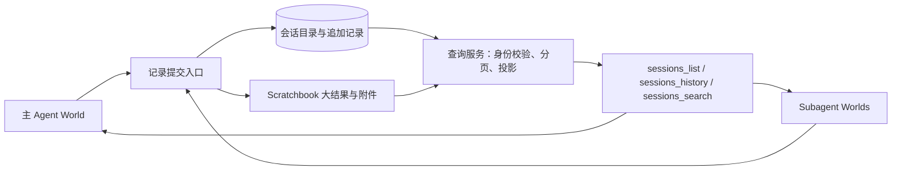

# Agent / Subagent 跨会话记录访问调研

调研日期：2026-10-18。项目基线：`f07e0afd264ad28df6dfbf5bd359008a6d58ba1f`。

本文保留调研时点的设计建议，当时尚未实现 API；后续落地接口与使用方式见 [Session records](../features/session-records.md)。外部结论来自官方文档和明确标注的源码快照；没有安装并运行这些框架做行为对比。OpenCode 的 V1 文档与 V2 实现分别标注，不能混用。

**建议采用“独立记录存储 + 按需查询工具”的方案：对外借鉴 OpenClaw 的 list/history/search，对内借鉴 OpenCode 的 session/message 身份与顺序模型，并保留 ECS 的独立 child World。** 现有 `subagent_result` 继续表示执行结果，新增能力负责读取执行过程。跨会话长期记忆可在此基础上另外建设。

## 1. 需求应覆盖哪些记录

| 记录 | 示例 | 所需能力 |
|---|---|---|
| 最终结果与产物 | reviewer 的结论、生成文件、失败原因 | 已有结果接口和 scratchbook 可复用 |
| 会话过程 | 用户任务、assistant 消息、工具调用与回执 | 新增按会话分页读取、按消息定位 |
| 执行状态 | 当前 run、完成 / 失败 / 取消、工具是否结束 | 记录有序生命周期事件，明确部分内容 |
| 过去任务中的信息 | 之前哪个 agent 调查过这个问题 | 先做原文搜索，再按需增加摘要或语义检索 |

这里的“记录”指框架实际保存的消息、工具输入输出、状态与产物。模型不公开的内部推理不能作为必需数据；provider 的私有回放字段也不应成为跨 agent 的通用记录格式。

## 2. 外部方案比较

| 系统 | 主要机制 | Agent 能否直接查其他会话 | 对本项目最有用的部分 |
|---|---|---|---|
| OpenClaw | 会话目录、历史读取、全文搜索、统一可见性规则 | 提供专门工具，受配置约束 | 最直接的工具接口参照 |
| Claude Code | 独立 subagent transcript、恢复子会话、跨会话发消息 | 已核实消息发现 / 发送；消息通道不传整段历史 | transcript 与主上下文分离；读取与通信分离 |
| OpenCode | 父子 session、结构化消息、数据库顺序、继续指定子会话 | V1 有宿主查询 API；已查 V2 内置工具未发现通用跨会话历史工具 | session 数据模型、直接父子关系校验 |
| LangGraph | thread checkpoint、子图状态、跨 thread Store | 宿主可检查状态；按需封装成模型工具 | 恢复快照、过程记录、长期记忆分层 |
| Google ADK | Session.events、分支上下文、MemoryService | `load_memory` 可查已入库记忆；原始会话走 SessionService | 同库存储与 prompt 可见性分别控制 |

### OpenClaw：最接近目标的现成接口

官方提供 `sessions_list`、`sessions_history`、`sessions_search`。模型可以先发现会话，再读取历史，或由搜索命中定位原文；读取支持工具结果开关和分页，响应携带截断等信息。其可见范围有 `self/tree/agent/all`，还叠加 agent-to-agent 与 sandbox 规则。[官方 Session tools](https://docs.openclaw.ai/concepts/session-tool)

本次查阅的文档中，普通未沙箱会话默认范围为 `all`；`tree` 对主会话存在额外例外，并非简单的“仅后代”。因此 ECS 应自行定义父子、兄弟和跨任务读取规则，不能只复制这些配置名。[官方范围说明](https://docs.openclaw.ai/concepts/session-tool#visibility)

源码快照 `6332e012a64cd68f0fd884ee32dbd87de8f3430e` 中，history 工具先解析请求方与目标身份，再校验可见性，之后调用 Gateway 的 `chat.history`，最后过滤工具消息并限制输出体积。这里的 sanitize 主要处理字段和长度，不能据此推断它会自动屏蔽凭据。[history 工具实现](https://github.com/openclaw/openclaw/blob/6332e012a64cd68f0fd884ee32dbd87de8f3430e/src/agents/tools/sessions-history-tool.ts)

**可借鉴的设计：** 发现、定位、读取使用同一访问规则；先过滤权限再产生摘要或命中片段；大结果明确说明截断；读取是一种独立操作，不需要唤醒目标 agent。

### Claude Code：持久记录、恢复与消息协作

普通 subagent 使用独立上下文，fork 是继承父会话的特殊情况。子 transcript 独立保存在父 session 下的 JSONL 文件中，主会话压缩不影响这些文件；恢复子 agent 可延续它保存的上下文。记录也受保留期约束。[官方 Subagents](https://code.claude.com/docs/en/sub-agents#manage-subagent-context)

目前官方还描述了 `ListAgents` 和 `SendMessage` 跨会话能力，但明确说明消息传递的是文本，不是发送方的整个会话历史或文件。[官方跨会话消息](https://code.claude.com/docs/en/cross-session-messaging)

**适用判断：** 它很适合“让另一个 agent 补充说明 / 继续工作”；如果需求是“精确核查它调用过哪个工具、原始输出是什么”，仍需 transcript 查询。不能把可恢复或可发消息写成已经提供任意跨会话历史读取工具。本次未核实到与 OpenClaw `sessions_history` 等价的通用官方工具契约。

### OpenCode：父子会话与结构化存储

V2 的 `subagent` 为前台和后台任务建立 child session；返回的 `sessionID` 可用于继续同一子会话，新会话从独立上下文开始。[V2 Agents](https://opencode.ai/v2/docs/agents#modes) / [V2 Tools](https://opencode.ai/v2/docs/tools#subagent)

在 `dev` 快照 `60a5a6ca7ce176b04cd2321ffd1819b1ea8e6006` 中：

- `session_v2` 保存项目、workspace、`parent_id` 与 fork 来源；`session_message` 保存 `session_id`、消息类型、`seq` 和结构化数据，并对 `(session_id, seq)` 建唯一索引。[存储 schema](https://github.com/anomalyco/opencode/blob/60a5a6ca7ce176b04cd2321ffd1819b1ea8e6006/packages/core/src/session/sql.ts)
- 继续旧 child 时验证 `existing.parentID === context.sessionID`；前台结果和后台回执都保留 child ID。[subagent 工具](https://github.com/anomalyco/opencode/blob/60a5a6ca7ce176b04cd2321ffd1819b1ea8e6006/packages/core/src/tool/plugin/subagent.ts)
- runner 使用的 history loader 会考虑 compaction 边界和 provider 回放兼容性，因此“加载给模型的当前历史”本身就不是无条件读取全部原文。[history 实现](https://github.com/anomalyco/opencode/blob/60a5a6ca7ce176b04cd2321ffd1819b1ea8e6006/packages/core/src/session/history.ts)

V1 的 Server 文档另有 `GET /session/:id/children`、`GET /session/:id/message` 和单条消息读取 API。这证明宿主具有查询接口，不等于每个模型默认拥有对应工具，也不应将这些路径直接当成 V2 API。[V1 Server](https://opencode.ai/docs/server/#sessions)

已查阅的 V2 工具文档与 `opencode` 工具 namespace 实现未列出通用 history/search 工具；这是一项调研范围内的观察，不排除插件扩展。[V2 工具 namespace 源码](https://github.com/anomalyco/opencode/blob/60a5a6ca7ce176b04cd2321ffd1819b1ea8e6006/packages/core/src/tool/plugin/opencode.ts)

**可借鉴的设计：** 每次子会话可寻址；父子关系显式存储；消息按稳定顺序读取；用于恢复的模型上下文与用于核查的历史视图分别定义。

### LangGraph：Checkpoint 与跨线程 Store

Checkpointer 保存某一 thread 的图状态；Store 保存跨 thread 的应用数据。`get_state_history(config)` 返回历史状态快照，包含 checkpoint 身份与执行信息；它不是天然去重的消息日志。[Persistence](https://docs.langchain.com/oss/python/langgraph/persistence) / [Checkpointers](https://docs.langchain.com/oss/python/langgraph/checkpointers)

`get_state(..., subgraphs=True)` 可检查子图，但官方明确要求子图可被静态发现；藏在 tool 函数等间接调用内的 subagent 不适用同样的状态检查。子图还区分每次调用隔离与同 thread 持续状态。[Subgraphs](https://docs.langchain.com/oss/python/langgraph/use-subgraphs#view-subgraph-state)

Store 按 namespace/key 组织数据，支持前缀过滤，后端可提供语义搜索。namespace 是组织数据的机制，应用仍需定义谁能查哪些 namespace。[Stores](https://docs.langchain.com/oss/python/langgraph/stores)

**适用判断：** 借鉴它的职责分离；ECS 的 checkpoint 继续服务恢复，记录库服务过程查询，共享记忆服务经验复用。不要将所有 checkpoint 内重复的 messages 直接堆成搜索语料。

### Google ADK：共享事件存储，按分支筛选上下文

ADK Session 按应用、用户和会话定位，`events` 保存交互顺序，Runner 经 SessionService 追加事件并更新状态。[Session 文档](https://adk.dev/sessions/session/)

官方 Python 仓库的 `single_turn` 指南描述：子调用在独立分支执行；加载历史时，子分支可以读取祖先事件，父分支的自动上下文不包含子分支内部事件；`include_contents="none"` 则跳过历史加载。这是该模式的上下文选择规则，不应泛化成所有 ADK 模式的授权边界。[single_turn 指南](https://github.com/google/adk-python/blob/main/docs/guides/agents/llm_agent/single_turn.md#how-context-isolation-works)

MemoryService 是另一条通道：应用先将会话或事件加入记忆，再由 `load_memory` / `search_memory` 检索。官方例子展示了不同 agent 共享服务后跨会话回忆信息。[Memory 文档](https://adk.dev/sessions/memory/)

**可借鉴的设计：** 记录可以进入共享后端，同时保持各 agent 的 prompt 独立；精确原文与派生记忆分开提供，并让后者保留来源。

## 3. ECS 当前基础与缺口

以下来自本地代码静态检查。

| 已有机制 | 能做什么 | 对跨 agent 查询的限制 |
|---|---|---|
| `ConversationComponent.messages/history_id/revision` | 保存当前工作历史和历史修订身份 | 压缩 / 裁剪会替换 messages；不是完整的持久记录库 |
| parent World 的 `ChildStubComponent` + Conversation | child 退出后保留一份工作历史 | 在委派 `finally` 中才复制；运行中不能据此读取最新历史，也可能已压缩 |
| `SubagentSessionRecord` | 后台会话状态、结果摘要、artifact 引用 | 当前同步委派没有这类 session；表里也没有完整 transcript |
| `ConversationArchiveComponent` | 保存 compaction 摘要 | 字段是 `archived_summaries`，没有原始消息全集 |
| scratchbook `ArtifactRegistry` / `ToolResultsSink` | 保存完整结果与工具回执 | 缺少统一的会话目录、消息顺序以及跨会话查询层 |
| observability / plugins | trace、run、generation、tool 等观测，向 child 传播 | 当前是观测输出管道，不提供有持久性承诺的记录查询 API |
| `subagent_resume` | 重启失败、超时或取消的后台任务 | 使用原 prompt 启动新 session，不是恢复旧 child transcript |

主要代码入口：

- [components/definitions.py](../../src/ecs_agent/components/definitions.py)：工作历史、摘要归档与 session table。
- [types.py](../../src/ecs_agent/types.py)：`SubagentSessionRecord`。
- [subagent/__init__.py](../../src/ecs_agent/systems/subagent/__init__.py)：`_execute_subagent_core` 的 child stub 同步、`_resume_session`。
- [subagent/tools.py](../../src/ecs_agent/systems/subagent/tools.py) / [tool_schemas.py](../../src/ecs_agent/systems/subagent/tool_schemas.py)：当前工具契约，明确同步调用无后台 session。
- [subagent/service.py](../../src/ecs_agent/systems/subagent/service.py) / [scratchbook/tool_sink.py](../../src/ecs_agent/scratchbook/tool_sink.py)：结果持久化。
- [history.py](../../src/ecs_agent/history.py) / [compaction.py](../../src/ecs_agent/systems/compaction.py)：历史替换与摘要处理。

两个实现细节需要提前处理：

1. **工具身份不能直接继承父闭包。** 当前 [child_world.py](../../src/ecs_agent/systems/subagent/child_world.py) 的工具继承会复制 handler。新查询工具若闭包绑定父 agent 身份，照搬后会把 child 当成父调用方。应共享后端服务，并为每个实际调用方重新绑定工具，或从可信运行上下文取得身份。
2. **EventBus 发布成功不代表记录写入成功。** 当前 [event_bus.py](../../src/ecs_agent/core/event_bus.py) 会记录 subscriber 异常但不向发布者抛出。若需要“消息已接受即能查询”的保证，不能只挂一个可能静默失败的持久化 subscriber；应有明确的提交路径与写入失败语义。

## 4. 建议架构



这个服务是跨 World 的运行时依赖。组件保存身份、策略和可序列化配置；数据库连接由应用装配，恢复 World 后重新绑定。保持现有 dataclass / Protocol 风格，不引入新的 Agent 基类。

### 4.1 分离三类标识

| 标识 | 建议语义 |
|---|---|
| `agent_session_id` | 一段可查询会话的持久身份，主 agent、同步和后台 child 都有 |
| `run_id` | 会话中的一次执行；继续同一会话可以产生新 run |
| 现有后台 `session_id` | 保留当前任务控制契约，通过 `transcript_session_id` 映射到记录会话 |

目录另外保存 `parent_session_id`、`root_session_id`、workspace / owner、agent 名称和创建时间。现有 `history_id/revision` 表示工作历史身份与变更，作为记录元数据保存。`entity_id` 在不同 World 中可能重复，只能作为辅助定位字段。

同步调用的记录可先通过 `sessions_list(parent=...)` 发现，避免为了返回 ID 立刻改变现有字符串结果契约。若后续需要直接返回 ID，再设计显式的结构化结果版本。

### 4.2 以追加事件保留过程，以工作历史驱动模型

建议记录字段：`record_id`、`agent_session_id`、`run_id`、单会话递增 `seq`、时间、事件类型、消息 / 工具调用身份、内容或 artifact 引用、完成状态。

- 已接受输入、assistant 完成消息、工具开始 / 完成 / 失败、run 终态进入记录层；工具调用 ID 与结果引用保持关联。
- compaction、trim、reset、revert 记录为变更事件，带原 history 身份与覆盖范围；工作上下文照常缩减。记录留存期限内仍可查旧证据。
- 若支持 ConversationTree，额外保留分支与消息父子关系；查询默认返回当前分支，历史分支显式选择，避免混合不同执行路径。
- 默认查询已提交的完整记录。正在流式生成的内容单独标记 `partial`；不必将每个 token 单独落库。
- 大型工具结果继续存 scratchbook，索引保存有归属的引用。跨 agent 展开原始结果时仍经查询服务校验，不向模型暴露任意路径读取入口。
- 旧 checkpoint / stub 只能回填当时仍存在的消息，必须标记来源与可能缺失，不能声称恢复出了已经裁剪的原文。

精确采集应逐步收敛当前分散的消息追加入口，包括 Reasoning、ToolExecution、UserInput、MessageBus、Planning、通知和历史替换。仅在每个 tick 结束时对组件拍快照，容易漏掉 tick 内被替换的内容，也会重复记录未变化的历史。

### 4.3 给模型的只读工具

下面是建议接口，名称与参数尚未定稿：

```text
sessions_list(parent_session_id?, agent_name?, status?, cursor?, limit?)
sessions_history(session_id, cursor?, after_seq?, before_seq?, limit?,
                 include_tools=False, max_chars?)
sessions_search(query, session_id?, agent_name?, limit?)
```

`sessions_list` 返回简短的任务、关系和状态，避免默认带全部 transcript。`sessions_history` 返回一页记录、`next_cursor`、`snapshot_seq`、会话是否结束及截断标记；`cursor/after_seq/before_seq` 互斥。续页游标携带固定的读取边界，避免其他 agent 追加消息导致漏项或重复；增量读取可用 `after_seq` 开启新快照。

搜索返回 `session_id + record_id/seq + snippet`，支持回到原文核对。第一版可使用字面关键词搜索；SQLite FTS 是否启用及中文分词策略应单独验证。向量检索作为后续可选后端，不作为历史读取的前置依赖。

这三个工具应使用 `inline_result=True`，否则查询结果被 ToolResultsSink 再次替换成归档路径，会复现当前项目已经处理过的读取循环问题。短状态和正文预算由查询服务控制。

### 4.4 查询范围与内容投影

建议默认允许读取自己的会话及后代；兄弟 agent 通过同任务树共享策略开放，跨任务树 / workspace 通过明确的读取授权开放。权限由运行时注入的调用方身份决定，工具参数只选择目标和过滤条件。

list、search、history、artifact 展开使用同一规则；搜索之前就限定可见集合，避免标题、片段、数量泄漏。只读历史不授予取消、继续或向目标发消息的能力。

给模型返回的是带来源的资料，保留目标 agent、session、工具和状态。不要把别的 agent 的 user/system 消息提升成当前会话的新指令，也不要把这些消息直接拼接成当前 provider 历史中的 tool 回执。默认投影省略系统配置、认证信息、私有 provider 回放内容和大块二进制。

### 4.5 存储选择

建议先提供 `RecordStore` Protocol 与 InMemory 后端验证契约，再以 SQLite 作为本地持久化后端：会话目录、记录、索引和提交边界放在同一事务中，便于处理多个 child World 并发追加。长内容继续引用 scratchbook，避免复制一套产物仓库。

如果近期仅做单进程原型，每会话 JSONL 也可行，便于检查和导出；但必须处理并发写入、崩溃后的半行、稳定游标和索引重建。最终应选一个权威记录源，不让 SQLite 与 JSONL 同时承担独立双写的真相源。

## 5. 分阶段实施建议

| 阶段 | 工作 | 验收结果 |
|---|---|---|
| P0：记录与读取 | 为主 / 同步 / 后台 child 分配持久身份；明确消息提交路径；实现持久后端、list/history 与基础访问规则 | 父 agent 能读取运行中及已完成 child 的已提交过程；重启后仍可读取 |
| P1：搜索与共享 | 关键词搜索、按命中定位、兄弟与跨任务显式共享、artifact 展开 | reviewer 能查到 coder 的工具证据，且无法越过配置范围 |
| P2：记忆与延续 | 可选摘要 / 语义索引，单独设计真正的会话继续或 fork | 旧任务经验可复用；派生结论能追溯到原始记录 |

实现时的关键验证场景：同步与后台委派都可发现；运行中分页稳定；取消和失败保留已提交内容并明确标注；压缩不影响保留期内的原文查询；两层 child 的身份绑定正确；读权限撤回后 list/search/history 一致；记录提交失败不伪装成完整历史；旧快照迁移明确披露缺口。

**建议先实现 P0，再做 P1。** 当前项目已经有结果存储、独立 child World 和结构化终态，最大的新增工作是统一会话身份与可靠记录提交，查询工具本身相对简单。
